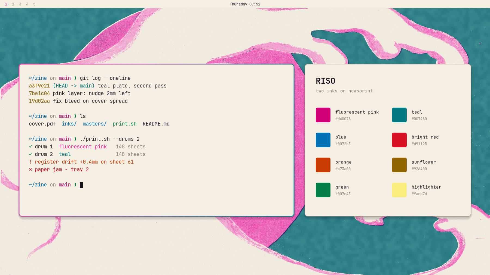
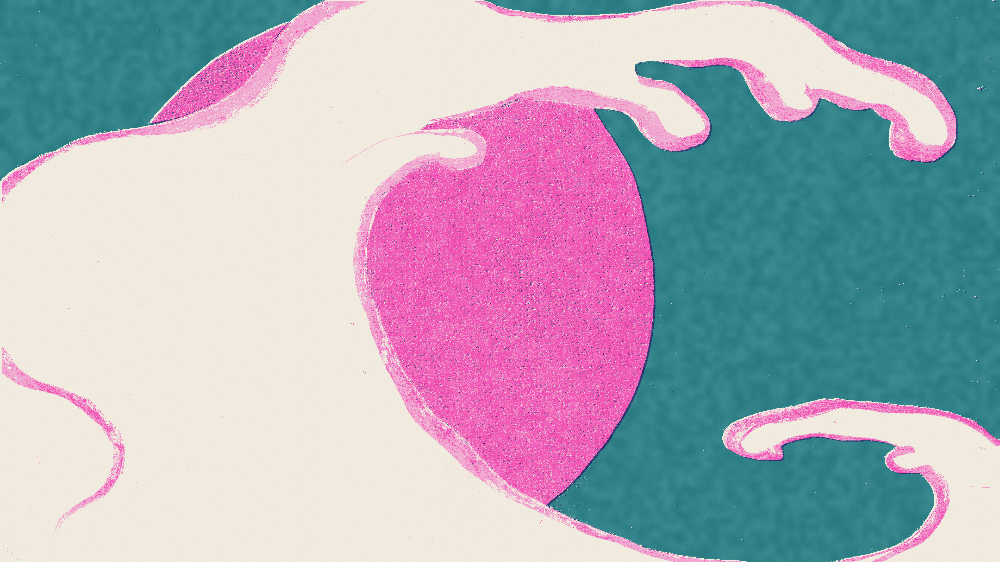
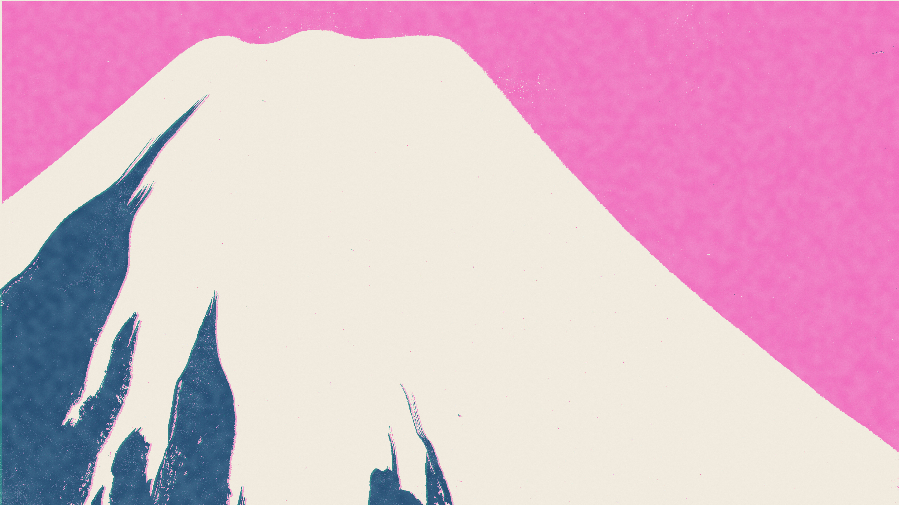
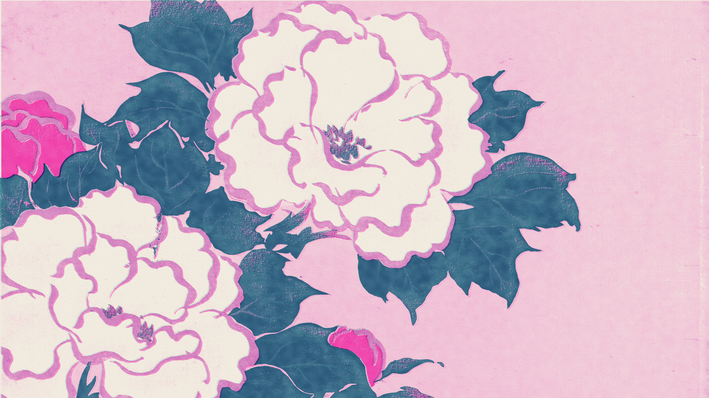
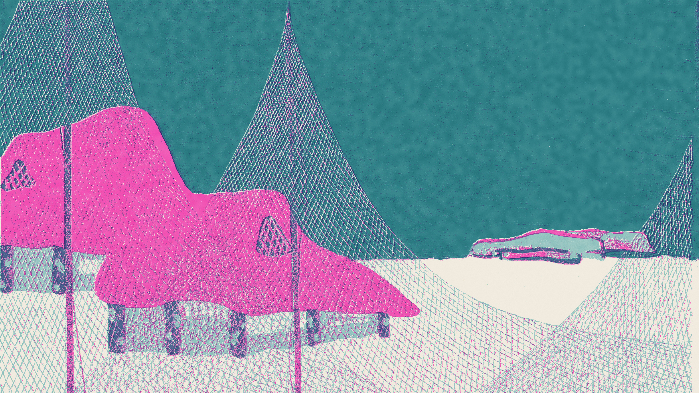

# Riso for Omarchy

A light [Omarchy](https://omarchy.org) theme: fluorescent pink and teal ink on warm newsprint, like a Risograph print. Every colour starts from a real Risograph ink and is darkened only as far as it needs to be readable on the paper; the raw inks live where nothing has to be read, in the window border and the wallpapers.



## Install

```bash
omarchy theme install https://github.com/YassineSawahi/omarchy-riso-theme
```

Cycle the wallpapers with `omarchy theme bg next`.

## Wallpapers

| | |
|---|---|
|  |  |
|  |  |

Four plates from Kamisaka Sekka's woodblock book *Momoyogusa*, re-separated into the theme's two inks, pink and teal, the way a Risograph prints one colour per drum.


| File | Source |
|---|---|
| `1-waves` | [Hoge golf Tatsunami](https://commons.wikimedia.org/wiki/File:Hoge_golf_Tatsunami_Bloemen_van_honderd_werelden_(serietitel)_Momoyogusa,_dl._1_(serietitel),_RP-P-1992-95.jpg), from Kamisaka Sekka's *Momoyogusa* (1909–10). Rijksmuseum, Amsterdam, CC0 |
| `2-fuji` | [De berg Fuji Fuji](https://commons.wikimedia.org/wiki/File:De_berg_Fuji_Fuji_Bloemen_van_honderd_werelden_(serietitel)_Momoyogusa,_dl._1_(serietitel),_RP-P-1992-101.jpg), from Kamisaka Sekka's *Momoyogusa* (1909–10). Rijksmuseum, Amsterdam, CC0 |
| `3-peonies` | [Pioenrozen Fukamigusa](https://commons.wikimedia.org/wiki/File:Pioenrozen_Fukamigusa_Bloemen_van_honderd_werelden_(serietitel)_Momoyogusa,_dl._1_(serietitel),_RP-P-1992-96.jpg), from Kamisaka Sekka's *Momoyogusa* (1909–10). Rijksmuseum, Amsterdam, CC0 |
| `4-village` | [Vissersdorpje Gyoson](https://commons.wikimedia.org/wiki/File:Vissersdorpje_Gyoson_Bloemen_van_honderd_werelden_(serietitel)_Momoyogusa,_dl._1_(serietitel),_RP-P-1992-92.jpg), from Kamisaka Sekka's *Momoyogusa* (1909–10). Rijksmuseum, Amsterdam, CC0 |

## Palette

Every normal colour reads at 4.5:1 or better against the background and every bright one at 3:1 or better.

| Slot | Value | Contrast |
|---|---|---|
| background | `#f5efe3` | |
| foreground | `#2a2833` | 12.65 |
| accent | `#d40078` | 4.51 |
| red | `#d91125` | 4.52 |
| orange | `#c73a00` | 4.55 |
| yellow | `#926400` | 4.53 |
| green | `#007e45` | 4.51 |
| cyan | `#007980` | 4.53 |
| blue | `#0072b5` | 4.50 |
| magenta | `#d40078` | 4.51 |
| brown | `#925f52` | 4.61 |
| bright red | `#f15060` | 3.03 |
| bright yellow | `#b87f00` | 3.02 |
| bright green | `#009f56` | 3.01 |
| bright cyan | `#00838a` | 3.97 |
| bright blue | `#0078bf` | 4.13 |
| bright magenta | `#ff2aa3` | 3.00 |
| muted | `#948978` | 3.00 |
| selection | `#faec7d` | text on it 12.0 |

Focused windows get a pink-to-teal border. Icons are `Yaru-magenta`.

## How it works

This repo is only files: a palette, the wallpapers and a few images. Omarchy does the rest, on your PC. Nothing runs and nothing goes over the network once it's cloned.

- `omarchy theme install` clones the repo into `~/.config/omarchy/themes/riso` and switches to it.
- Switching copies the theme into `~/.local/state/omarchy/current/theme` and renders every app's config (terminals, Hyprland, Neovim, btop, VS Code, the bar) from `colors.toml` through Omarchy's own templates. The theme ships no app configs of its own.
- `icons.theme` names the icon theme, `Yaru-magenta`, which Omarchy sets for GTK apps.
- `backgrounds/` holds the wallpapers. `omarchy theme bg next` cycles through them.
- `preview.png` is what Omarchy's theme picker shows.
- `unlock.png` is the logo for the boot screen where you type your disk password, and `preview-unlock.png` its preview. They're only used if you pick Riso under Omarchy menu → Appearance → Unlock, which asks for your password because the boot screen is system-wide.

## License

MIT. The wallpapers are derived from CC0 works, credited above.
